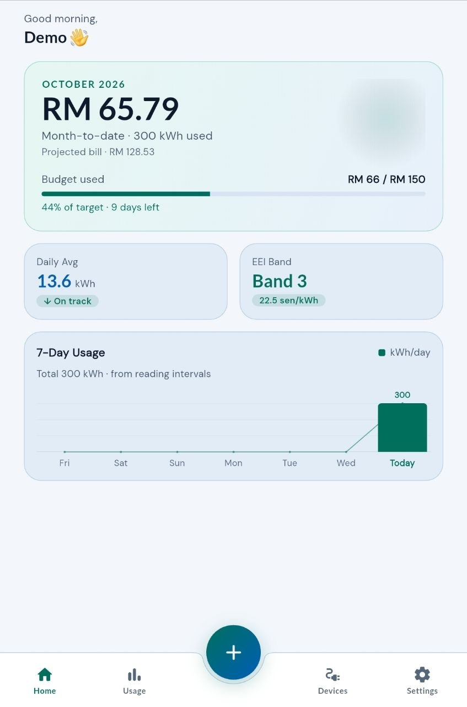
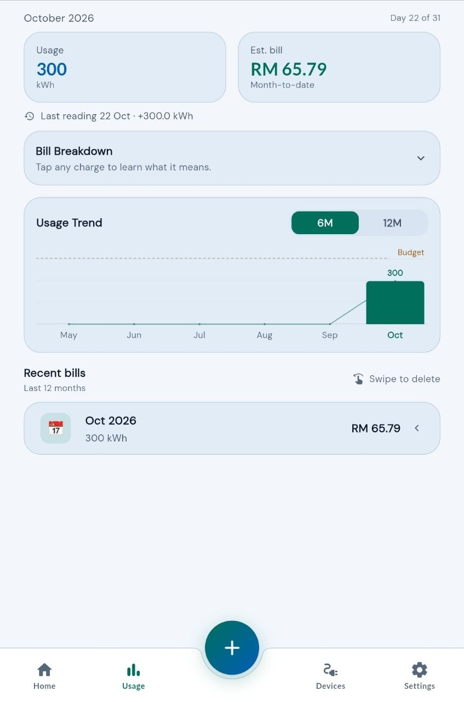
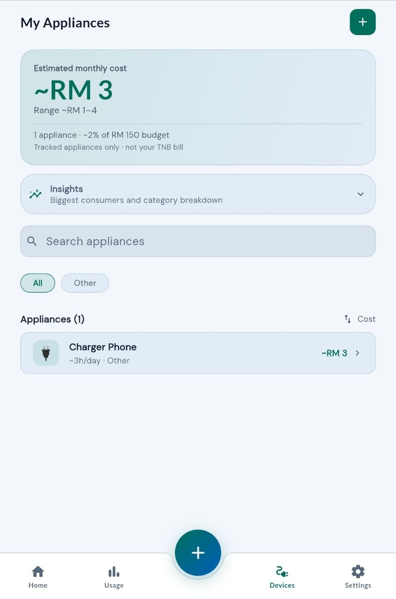

# Energy Tracker

A Flutter app for Malaysian domestic TNB customers. Log meter readings, see where your usage is heading, estimate the bill using the current domestic tariff, and keep spending inside a monthly budget.

> Detailed product, architecture, billing, data, and development documentation lives in [`docs/`](docs/README.md).

## 📦 Live APK (Download & Test)

Latest build is automatically generated via GitHub Actions:

👉 View latest release: https://github.com/H4DRI165/energy-tracker/releases/latest

Built for portfolio demonstration — install and test without any setup required.

### Demo account

Use email sign-in with the demo account:

```text
Email:    demo@test.gmail.com
Password: Demo123@
```

Google sign-in uses your own Google account.

## Screenshots

<p align="center">
  
  
  
</p>

## Features

- **Meter readings** — manual readings with automatic kWh deltas and chain-safe edit/delete.
- **Dashboard** — month-to-date usage, projected bill, budget progress and a 7-day chart.
- **Bill detail** — itemised TNB-style charges with plain-language explanations and reading details.
- **Usage** — monthly usage trend, budget pace and recent bill history.
- **Appliances** — estimated running costs, biggest consumers and category breakdowns.
- **Tariff calculator** — itemised estimate for any monthly kWh value.
- **Budget alerts** — optional 80% / 100% push notifications.
- **Google and email sign-in** — account creation, password reset and Google onboarding.
- **Light / dark mode** — persisted preference with a smooth theme transition.
- **Offline-aware writes** — clear connection errors instead of endless loading.

## Domestic tariff

Domestic TNB tariff only. The estimate includes every applicable charge and
does not model commercial tariffs, net metering, or bill payment.

| Component | Rate / rule |
|---|---|
| Energy | 27.03 sen/kWh up to 1,500 kWh; 37.03 sen/kWh above 1,500 kWh |
| Capacity | 4.55 sen/kWh |
| Network | 12.85 sen/kWh |
| Retail | RM 10/month above the protection threshold |
| EEI | 0.5–25 sen/kWh rebate, based on whole-month usage |
| AFA | Published monthly; applies above the protection threshold |
| KWTBB | 1.6% of eligible charges above 300 kWh |
| SST | 8% on the taxable slice above the protection threshold |

**Protection threshold:** 600 kWh, or 800 kWh from September to December 2026.

> AFA is included automatically from the published monthly tariff schedule.
> Energy Tracker is an estimator, not an official TNB invoice.

## Tech stack

| Layer | Technology |
|---|---|
| App | Flutter / Dart, Riverpod, go_router |
| Backend | Firebase Auth, Cloud Firestore, Cloud Functions |
| Push notifications | Firebase Cloud Messaging, flutter_local_notifications |
| Storage | Firebase Storage |
| Reporting | Firebase Crashlytics |
| Integrity | Firebase App Check |
| CI/CD | GitHub Actions |
| UI | flutter_screenutil, Google Fonts (bundled locally) |

## Run locally

```bash
flutter pub get
flutter run
```

Local Firebase configuration is required; see [docs/DEVELOPMENT.md](docs/DEVELOPMENT.md).

## Build

```bash
flutter build apk --release
```

GitHub Actions runs analysis and tests on pull requests and `main`. Signed
release APKs are built on `main` and manual runs; `main` builds are published
to GitHub Releases:

https://github.com/H4DRI165/energy-tracker/releases/latest

## Documentation

- [Documentation index](docs/README.md)
- [Product requirements](docs/PRD.md)
- [Architecture](docs/ARCHITECTURE.md)
- [Features](docs/FEATURES.md)
- [Billing and tariff logic](docs/BILLING.md)
- [Firestore data model](docs/DATA_MODEL.md)
- [Development guide](docs/DEVELOPMENT.md)
- [Glossary](docs/GLOSSARY.md)
